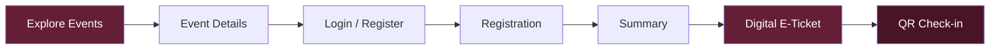
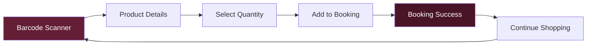

<div align="center">


<picture>
  <source media="(prefers-color-scheme: dark)" srcset="assets/img/readme/aurora-dark.svg" />
  
</picture>

<p align="center">
  
</p>
<br />

### DIGITAL EVENT &amp; BOOKING MANAGEMENT SYSTEM

<picture>
  <source media="(prefers-color-scheme: dark)" srcset="https://readme-typing-svg.demolab.com?font=Plus+Jakarta+Sans&weight=600&size=20&duration=3200&pause=1000&color=F7F2F3&center=true&vCenter=true&width=640&lines=A+Modern+Multi-Page+Event+Booking+Experience;Designed+with+a+Burgundy+%26+White+Identity;One+Platform.+Multiple+Experiences." />
  
</picture>

<br />


<br />

[](#about)
[](#core-features)
[](#application-journeys)
[](#technology-stack)
[](#project-structure)
[](#run-locally)
[](#demo-access)

<picture>
  <source media="(prefers-color-scheme: dark)" srcset="assets/img/readme/shimmer-dark.svg" />
  
</picture>

<table align="center" width="100%">
  <tr>
    <td width="50%" align="center">

<picture>
  <source media="(prefers-color-scheme: dark)" srcset="assets/img/readme/stat-pages-dark.svg" />
  
</picture>

</td>
    <td width="50%" align="center">

<picture>
  <source media="(prefers-color-scheme: dark)" srcset="assets/img/readme/stat-journeys-dark.svg" />
  
</picture>

</td>
  </tr>
  <tr>
    <td width="50%" align="center">

<picture>
  <source media="(prefers-color-scheme: dark)" srcset="assets/img/readme/stat-limit-dark.svg" />
  
</picture>

</td>
    <td width="50%" align="center">

<picture>
  <source media="(prefers-color-scheme: dark)" srcset="assets/img/readme/stat-build-dark.svg" />
  
</picture>

</td>
  </tr>
</table>

</div>


## About

**Event Booking** is a web-based prototype developed for **PT Duta Abadi Primantara (PT DAP)**. It brings event registration, digital ticketing, QR check-in, barcode-based product booking, and account management into one connected platform.

The application evolves from a single-page concept into a structured **multi-page architecture**, preserving its original interface, functionality, and user experience. Its visual identity pairs an elegant Burgundy interface with an animated Swirl background on the Home Screen.

> **One platform. Multiple experiences. A connected digital journey.**

<div align="center">

<picture>
  <source media="(prefers-color-scheme: dark)" srcset="assets/img/readme/shimmer-dark.svg" />
  
</picture>

</div>

## Core Features

<div align="center">

<picture>
  <source media="(prefers-color-scheme: dark)" srcset="assets/img/readme/ticker-dark.svg" />
  
</picture>

</div>

<table>
  <tr>
    <td align="center" width="25%"><b>Event Discovery</b><br /><sub>Browse, search, and explore events</sub></td>
    <td align="center" width="25%"><b>Registration</b><br /><sub>Participant registration and confirmation</sub></td>
    <td align="center" width="25%"><b>Digital Ticketing</b><br /><sub>E-ticket generation and QR codes</sub></td>
    <td align="center" width="25%"><b>QR Check-in</b><br /><sub>Simulated attendance verification</sub></td>
  </tr>
  <tr>
    <td align="center"><b>Barcode Booking</b><br /><sub>Scan products and access product details</sub></td>
    <td align="center"><b>Booking Management</b><br /><sub>Quantity control, history, and details</sub></td>
    <td align="center"><b>User Account</b><br /><sub>Profile, notifications, and security</sub></td>
    <td align="center"><b>Interactive UI</b><br /><sub>Responsive layouts and animated visuals</sub></td>
  </tr>
</table>


## Application Journeys

### 01 &nbsp;Event Registration



### 02 &nbsp;Product Booking



<sub>Product booking follows a barcode-first workflow. Maximum quantity: **5 items per booking**. No public product catalog is provided.</sub>

<div align="center">

<picture>
  <source media="(prefers-color-scheme: dark)" srcset="assets/img/readme/divider-a-dark.svg" />
  
</picture>

</div>

## Technology Stack

<div align="center">


</div>

| Layer | Implementation |
|:---|:---|
| Structure | HTML5 multi-page architecture |
| Interface | CSS3 and responsive styling |
| Application Logic | Vanilla JavaScript |
| Data Persistence | Browser localStorage |
| Visual Elements | SVG, transitions, and animations |
| Typography | Plus Jakarta Sans |

**Architecture:** modular JavaScript, shared application state, centralized route definitions, reusable page modules, and classic script loading without mandatory build tools.

<div align="center">

<picture>
  <source media="(prefers-color-scheme: dark)" srcset="assets/img/readme/divider-b-dark.svg" />
  
</picture>

</div>

## Visual Experience

<div align="center">


**BURGUNDY × WHITE × MOTION**

</div>

The Home Screen integrates an animated Swirl background adapted from a separate visual project:

- Original SVG paths, gradients, and animation keyframes.
- Dedicated `swirl-` CSS namespace.
- Layered behind the hero interface.
- Pauses when the hero is not visible or the browser tab is inactive.
- Supports reduced-motion preferences.
- Limited to the Home Screen to preserve clarity throughout the application.

<div align="center">

<picture>
  <source media="(prefers-color-scheme: dark)" srcset="assets/img/readme/shimmer-dark.svg" />
  
</picture>

</div>

## Project Structure

<details open>
<summary><b>Browse the file tree</b></summary>

```text
Event-Booking/
│
├── index.html
├── home.html
├── events.html
├── event-detail.html
├── login.html
├── register.html
│
├── register-event.html
├── register-event-summary.html
├── registration-success.html
│
├── tickets.html
├── ticket-detail.html
├── check-in.html
│
├── scanner.html
├── product-detail.html
├── booking-success.html
├── booking-history.html
├── booking-detail.html
│
├── profile.html
├── notifications.html
├── privacy-security.html
├── change-password.html
│
└── assets/
    ├── css/
    ├── js/
    │   ├── core/
    │   ├── shared/
    │   ├── pages/
    │   └── effects/
    ├── img/
    └── fonts/
```

</details>

<div align="center">

<picture>
  <source media="(prefers-color-scheme: dark)" srcset="assets/img/readme/divider-a-dark.svg" />
  
</picture>

</div>

## Run Locally

No `npm install`, bundler, or build process is required.

```bash
git clone https://github.com/sirajfatwasidqy/Event-Booking.git
cd Event-Booking
python3 -m http.server 8000
```

Open `http://localhost:8000/` in your browser, or use the VS Code **Live Server** extension.

<div align="center">


<picture>
  <source media="(prefers-color-scheme: dark)" srcset="assets/img/readme/shimmer-dark.svg" />
  
</picture>

</div>

## Demo Access

| Credential | Value |
|:---|:---|
| Email | `siraj.fatwa@example.com` |
| Password | `Demo@2026` |
| Storage Key | `ecbs.v1` |

Demo Tools provide sample registrations, two sample bookings, four notifications, and a data reset option.

<sub>Demo credentials are for local prototype testing only. All demonstration data is stored in browser localStorage.</sub>

<div align="center">

<picture>
  <source media="(prefers-color-scheme: dark)" srcset="assets/img/readme/divider-b-dark.svg" />
  
</picture>

</div>

## Design System

<div align="center">

| BURGUNDY | DARK BURGUNDY | WHITE | SOFT SURFACE |
|:---:|:---:|:---:|:---:|
|  |  |  |  |
| `#641E35` | `#4A1427` | `#FFFFFF` | `#F7F2F3` |

**Typography:** Plus Jakarta Sans

</div>

## Quality &amp; Scope

The project includes `CROSS-CHECK-REPORT.md` for implementation review, covering:

- Page navigation and route consistency.
- Authentication and protected pages.
- Registration and ticket workflows.
- QR and barcode prototype interactions.
- Booking quantity restrictions.
- Responsive layouts and script loading order.
- Swirl animation and accessibility behavior.

> [!NOTE]
> **Prototype limitations:** Authentication, QR check-in, and barcode workflows are simulated. Data persistence uses browser localStorage. No production backend, live payment, or production transaction infrastructure is implied.

<div align="center">

<picture>
  <source media="(prefers-color-scheme: dark)" srcset="assets/img/readme/footer-dark.svg" />
  
</picture>


### EVENT BOOKING

**PT DUTA ABADI PRIMANTARA**

*Designed with purpose. Structured with precision. Built for a connected experience.*


</div>
